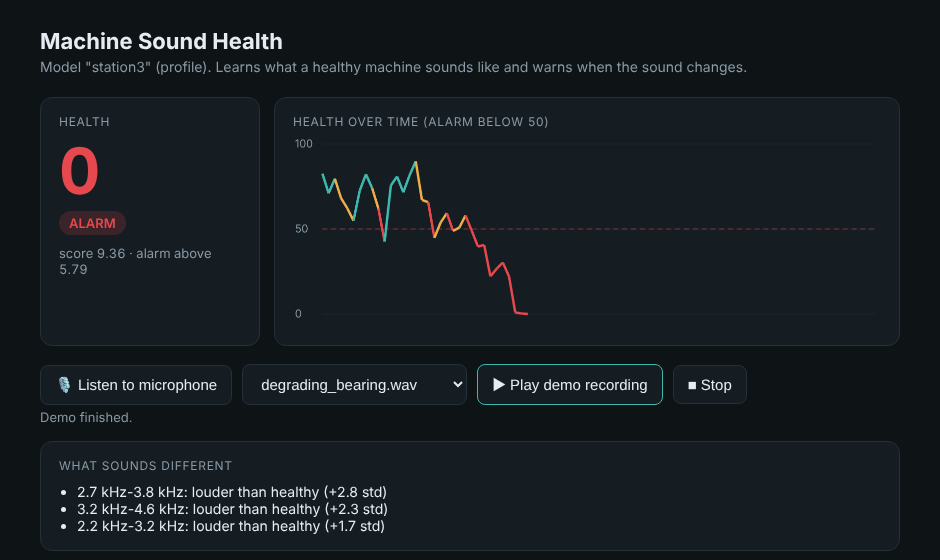
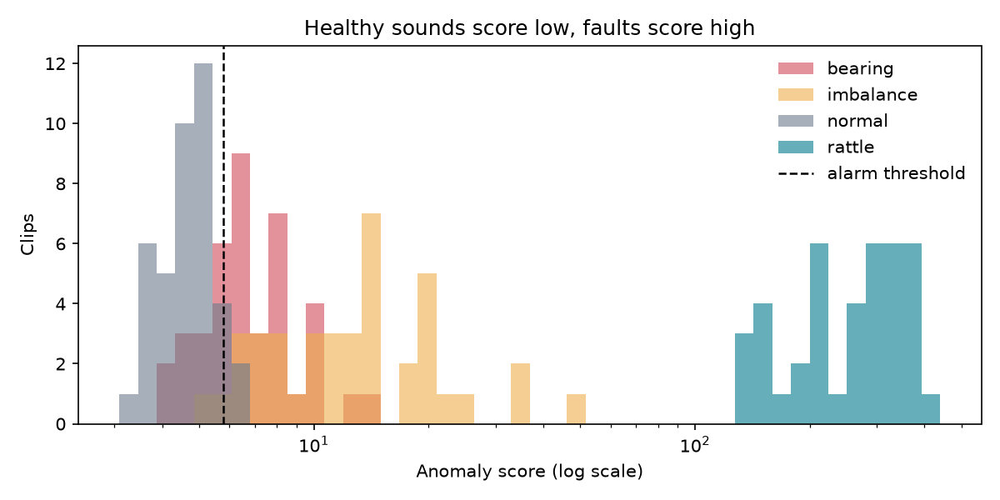
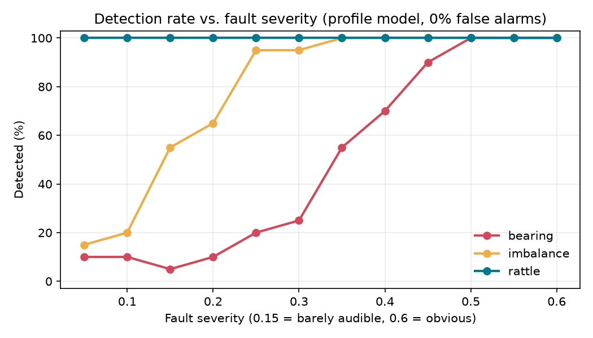

# Machine Sound Anomaly Detection

**Predictive maintenance by listening.** The detector learns what a *healthy* machine sounds like and warns when the sound starts to change, often before a part actually fails. It needs no examples of faults, only a few minutes of normal operation.



*Live dashboard replaying a recording in which a bearing fault slowly develops. Health drops from about 80 to the alarm zone, and the hints point to 2.7–3.8 kHz, where the simulated bearing resonance sits.*

## Results

Tested on 160 clips it never heard: 40 healthy, plus 40 each of three fault types at random severities, from barely audible to obvious.

| Fault | What it sounds like | AUC | Detected at the alarm threshold |
|---|---|---|---|
| Bearing damage | fast metallic clicks, 3–4 kHz | 0.88 | 73% |
| Imbalance | stronger rotation hum that wobbles about once a second | 0.99 | 95% |
| Loose part | short random rattles | 1.00 | 100% |
| **All faults** | | **0.96** | false alarms on healthy clips: 5% |



How bad must a fault be before it's caught? Rattles are found at once, imbalance from moderate levels, and bearing damage once it's clearly audible:



## How it works

```
microphone ─► 5 s window ─► mel spectrogram (16 bands) ─► sound profile ─► distance to healthy ─► health 0–100
                                                         (level + fluctuation    (Mahalanobis)          + which bands changed
                                                          per band)
```

1. **Sound profile.** For every 5-second window: the average loudness of 16 frequency bands, and how much each band fluctuates over time.
2. **Learn healthy.** From healthy clips only, the model learns the typical profile and how the features vary together (covariance with Ledoit-Wolf shrinkage, which stays stable with little data).
3. **Score.** The Mahalanobis distance from the healthy profile is the anomaly score. The alarm threshold comes from healthy clips held back during training.
4. **Explain.** The bands that deviate most are reported in plain language, for example *"2.7 kHz–3.8 kHz: louder than healthy"*. That tells a technician where to look: high frequencies point to bearings, low ones to imbalance.

## What I tried, and what I learned

I started with the **standard autoencoder** used as the baseline in the [DCASE challenge](https://dcase.community/) for machine sound anomaly detection: a neural network that learns to rebuild 160 ms slices of healthy spectrograms.

| Model | Bearing | Imbalance | Rattle | All faults |
|---|---|---|---|---|
| Autoencoder (DCASE-style baseline) | 0.74 | 0.57 | 1.00 | 0.77 |
| Sound profile, 64 bands | 0.86 | 0.95 | 1.00 | 0.94 |
| **Sound profile, 16 bands (final)** | **0.88** | **0.99** | **1.00** | **0.96** |

(AUC on the same test set.)

- **Why the autoencoder missed imbalance:** the fault is a slow wobble, about once per second, but the network only sees 160 ms at a time. Each slice looks normal; only the pattern over seconds is unusual. Adding *fluctuation over time* as a feature fixed this.
- **Why fewer bands are better:** with 64 bands the model has 128 features to estimate. With only 25–50 healthy clips (a few minutes of recording) it overfits and raises false alarms. With 16 bands it works well from about 25 clips, which is realistic for a technician recording a machine on site.
- **Testing the live demo found two bugs:** stitched-together clips created fake alarms at the joins, and silence at the end of a recording scored as a huge anomaly. The live demo now uses one continuous recording, and silence returns "no sound" instead of an alarm.

The autoencoder is still included (`--method autoencoder`) as the baseline to compare against.

## Quick start

```bash
bash scripts/quickstart.sh       # installs, generates data, trains, evaluates, starts the dashboard
```

Then open http://localhost:8000 and click **Play demo recording**.

Step by step:

```bash
python -m venv .venv && source .venv/bin/activate
pip install -r requirements.txt

python scripts/make_demo_data.py        # synthetic machine sounds (~50 MB)
python scripts/train.py                 # sound-profile model (1 second)
python scripts/evaluate.py              # AUC table + plots in docs/
python scripts/severity_sweep.py        # detection vs. fault severity

uvicorn msad.app:app                    # dashboard
```

## Try it on a real machine

A fan, fridge, washing machine or 3D printer all work:

```bash
# 1. Record 3 minutes of normal operation (microphone close to the machine)
python -m msad.cli record my_fan --seconds 180

# 2. Train
python scripts/train.py --data data_my_fan --out models/my_fan

# 3. Watch it live. Then change something (another fan speed, tape a paper strip to a blade...)
python -m msad.cli monitor --model models/my_fan
```

Example output (from the demo machine):

```
  12s  ████████████████████████░░░░░░  79.4  ok     (score 4.12)
  13s  ███████████████████░░░░░░░░░░░  63.0  watch  (score 5.10)
  14s  ██████████░░░░░░░░░░░░░░░░░░░░  33.1  ALARM  (score 6.89)
          ↳ 2.7 kHz-3.8 kHz: louder than healthy (+2.8 std)
```

For the dashboard with your own model: `MSAD_MODEL=models/my_fan uvicorn msad.app:app`.

## Data

Real factory recordings are rarely public, so `msad/synth.py` generates a demo machine ("Station 3", a screwdriving cell): a motor hum with harmonics, a gearbox tone and hall noise, with natural variation in speed, loudness and noise between clips. The faults are added at random severities. All sounds are synthetic.

For real recordings, use the [MIMII dataset](https://zenodo.org/records/3384388) (fans, pumps, valves, slide rails) or the DCASE task 2 data. Put the normal training clips in `<folder>/train/normal/` and test clips in `<folder>/test/<class>/`, then run `train.py --data <folder>`.

## Project structure

```
msad/
  model.py        sound-profile detector + autoencoder baseline, training, save/load
  synth.py        synthetic machine sounds and faults
  cli.py          record, score, live monitor
  app.py          FastAPI dashboard backend
  static/         dashboard page (live chart, microphone, demo replay, file upload)
scripts/          make data, train, evaluate, severity sweep, quickstart
tests/            end-to-end tests (pytest)
docs/             result plots
```

## Ideas for next steps

- Test on the MIMII dataset and compare with published DCASE results
- Track health over days and predict *when* it will cross the alarm line
- Run on a Raspberry Pi with a USB microphone next to the machine
- Send the alarm with its explanation to a voice assistant ([Audio RAG](https://github.com/Basill07/audio-rag)) that looks up the matching repair steps
